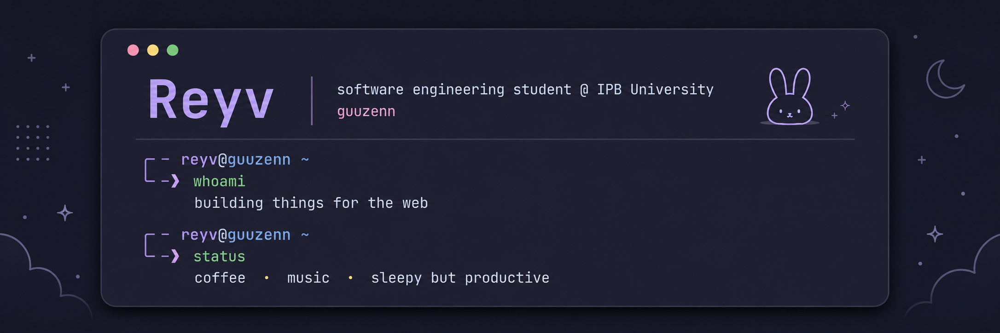

  

 

<h3 align="center">୨୧ about me</h3>

  Software Engineering student at IPB University. 
  Building things for the web and occasionally breaking them. 
  <i>coffee · music · questionable sleep schedule</i>

 

<h3 align="center">୨୧ stack</h3>

  
  
  
  

 

<h3 align="center">୨୧ github</h3>

  

  
  

 

  ☕ probably coding somewhere · 🐇

